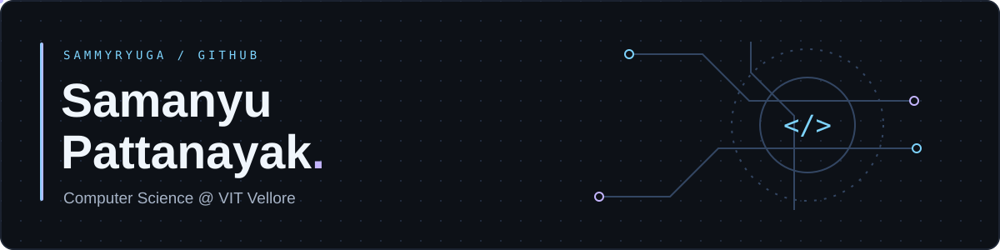

  
  

### A little about me

Computer Science student at **VIT Vellore**. I enjoy figuring out how things work, then building something with what I learn — from Python tools and cloud applications to interactive worlds in Unity.

### My toolkit

**Languages**

**Backend & cloud**

**Interactive development & tools**

### Things I've built

| Under the hood | Beyond the terminal |
| :--- | :--- |
| **[NEXUS OS](https://github.com/SammyRyuga/NEXUS-OS)** — live process telemetry and workload controls | **[REMNANT](https://github.com/SammyRyuga/REMNANT_WT)** — a team-built Unity VR experience |
| **[Cloud Intent Guardian](https://github.com/SammyRyuga/Cloud-Intent-Guardian)** — checking AWS infrastructure against architecture intent | **[AQI Index Predictor](https://github.com/SammyRyuga/AQI-INDEX-PREDICTOR)** — a team project exploring air-quality prediction |
| **[sqlite-workqueue](https://github.com/SammyRyuga/sqlite-workqueue)** — persistent jobs, worker leases and retries | **[Investment Garden](https://github.com/SammyRyuga/Investment_Garden)** — financial literacy through interactive play |

### The last 31 days

### A year, one bite at a time

<picture>
  <source media="(prefers-color-scheme: dark)" srcset="./assets/github-snake-dark.svg" />
  <source media="(prefers-color-scheme: light)" srcset="./assets/github-snake.svg" />
  
</picture>

My contribution history, remixed. The snake refreshes daily.

---

Samanyu Pattanayak · Computer Science @ VIT Vellore

